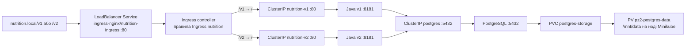

# Nutrition API: Java + PostgreSQL у Minikube

Три Deployment: Java `nutrition-v1`, Java `nutrition-v2` та `postgres`.
Кожен Pod містить один контейнер. Дві версії Java використовують одну базу.
Логери, проксі-застосунок, emptyDir і прямі hostPath-монтування Pod видалено.
Java та PostgreSQL виводять логи у stdout (`kubectl logs`).



LoadBalancer передає TCP/HTTP-трафік до **контролера Ingress**. Сам об’єкт
Ingress — це правила маршрутизації, які застосовує контролер.
Для Minikube використано addon `ingress` (NGINX), а не Traefik CRD із k3s.
Усі команди `kubectl` явно використовують контекст `minikube`.

## Файли Kubernetes

| Файл у `k8s/` | Призначення |
| --- | --- |
| `namespace.yaml` | Namespace `pz2` |
| `config.yaml` | ConfigMap: `POSTGRES_USER`, `POSTGRES_DB` |
| `secret.yaml` | Secret: `POSTGRES_PASSWORD` у base64 |
| `postgres-pv.yaml` | Статичний PV: 1 GiB, ReadWriteOnce, Retain, `/mnt/data` |
| `postgres-pvc.yaml` | PVC, явно прив’язаний до цього PV |
| `postgres-deployment.yaml` | Один PostgreSQL, probes, TCP 5432, PVC mount |
| `postgres-service.yaml` | ClusterIP для PostgreSQL |
| `java-deployment.yaml` | Два документи Deployment: v1 і v2, probes, CPU/RAM, TCP 8181 |
| `java-service.yaml` | Два документи ClusterIP Service: порт 80 → named targetPort `http` (8181) |
| `ingress.yaml` | `nutrition.local/v1` → v1; `/v2` → v2; видалення префікса |
| `loadbalancer.yaml` | Service у namespace `ingress-nginx`, вибирає Pod контролера |
| `kustomization.yaml` | Збирає конфігурацію застосунку у namespace `pz2` |

Для двох незалежно доступних версій Java потрібні два Service, щоб їхні
selectors не змішували Pod різних версій. Разом із PostgreSQL це три
ClusterIP Service застосунку. У Java Deployment selectors містять `version`.
Кількість реплік Java можна збільшувати незалежно: Service розподілить
з’єднання між готовими Pod відповідної версії. PostgreSQL залишайте з однією
реплікою та стратегією `Recreate`.

Порт 80 Java Service — внутрішній порт кластера, а не автоматично відкритий
порт хоста. Зовнішній доступ надає LoadBalancer контролера.
`loadbalancer.yaml` застосовується окремо: він повинен залишатися у
`ingress-nginx`, де працюють Pod контролера, а не потрапляти у `pz2` через Kustomize.

## Запуск

Потрібні Docker, Minikube, kubectl; для перевірки також curl і Python 3.
Docker Desktop у WSL потребує увімкненої WSL integration. Запускайте від
звичайного користувача без sudo:

```bash
bash scripts/check-access.sh docker
bash scripts/deploy.sh
```

Скрипт виділяє 2 CPU / 4 GiB RAM, вмикає `ingress` і `metrics-server`, збирає
та імпортує `nutrition-api:v1-<build-id>` і `nutrition-api:v2-<build-id>`, запускає PostgreSQL,
потім Java та маршрутизацію. Потрібен інтернет для образів і Gradle-залежностей.
JDK 25 використовується всередині Dockerfile, локальна Java не обов’язкова.
Повторний deploy застосовує конфігурацію та оновлює обидві версії Java.
Незмінний Deployment PostgreSQL не перезапускається. Зміна образу або Pod template
самого PostgreSQL спричинить його заміну зі стратегією `Recreate` і короткочасною
недоступністю БД. ConfigMap/Secret у змінних середовища вже запущеної БД самі
не оновлюються: такі зміни застосовуйте окремо, зі свідомим перезапуском PostgreSQL.

Кожна збірка має окремий тег: у CI він містить SHA коміту, ID запуску та номер
спроби; локально — SHA, UTC-час та випадковий суфікс. Скрипт генерує тимчасовий
маніфест із цими тегами, не змінюючи файли в репозиторії. Зміна image автоматично
запускає rollout Java; примусові `rollout restart` більше не потрібні.
`maxUnavailable: 0`, `maxSurge: 1` зберігають старий готовий Pod до готовності
нового (включно з доступністю БД). Для цього потрібні вільні ресурси ноди;
це зменшує переривання, але не гарантує успіх кожного запиту в польоті.

Спостерігати за оновленням можна через:

```bash
kubectl --context=minikube -n pz2 get pods -w
kubectl --context=minikube -n pz2 get deployments -o custom-columns='NAME:.metadata.name,IMAGES:.spec.template.spec.containers[*].image'
```

Під час звичайного оновлення змінюються Java Pod, а ім’я та вік Pod PostgreSQL
залишаються тими самими. За потреби повернення попередньої Java-версії:

```bash
kubectl --context=minikube -n pz2 rollout undo deployment/nutrition-v2
kubectl --context=minikube -n pz2 rollout status deployment/nutrition-v2 --timeout=300s
```

Попередній образ має залишатися у Minikube; rollback коду не скасовує SQL-міграції.
Наступний CI deploy знову встановить поточну збірку репозиторію.

Якщо у кластері є старий combined Deployment `nutrition`, скрипт зупиняється
до зміни даних: див. міграцію нижче. Старий PVC не видаляється автоматично.

Рекомендований шлях — `scripts/deploy.sh`, який підставляє теги збірки.
Наведений нижче ручний варіант використовує базові теги `nutrition-api:v1` і
`nutrition-api:v2`: спочатку окремо зберіть та імпортуйте образи саме з цими
тегами й увімкніть аддони. Не застосовуйте базові маніфести поверх CI deployment,
якщо не хочете переключити його з тегів збірки назад на базові:

```bash
kubectl --context=minikube apply -k k8s
kubectl --context=minikube apply -f k8s/loadbalancer.yaml
kubectl --context=minikube -n pz2 rollout status deployment/postgres --timeout=300s
kubectl --context=minikube -n pz2 rollout status deployment/nutrition-v1 --timeout=300s
kubectl --context=minikube -n pz2 rollout status deployment/nutrition-v2 --timeout=300s
```

Java підключається через `jdbc:postgresql://postgres:5432/$(POSTGRES_DB)`;
Kubernetes підставляє змінну БД з ConfigMap перед стартом контейнера.
Користувач і пароль беруться через `configMapKeyRef` / `secretKeyRef`.
Readiness Java перевіряє також доступність БД, liveness — лише стан JVM/застосунку.

## LoadBalancer, Ingress та /etc/hosts

В окремому терміналі залиште працювати:

```bash
minikube -p minikube tunnel
```

Тунель забезпечує локальний доступ до Service типу LoadBalancer і може
попросити системний пароль для налаштування маршрутів. Сам Minikube
залишається запущеним від звичайного користувача.
Див. [документацію Minikube](https://minikube.sigs.k8s.io/docs/handbook/accessing/).

Знайдіть EXTERNAL-IP:

```bash
kubectl --context=minikube -n ingress-nginx get service nutrition-ingress
```

Додайте до `/etc/hosts` **фактичну** адресу з EXTERNAL-IP, наприклад:

```text
127.0.0.1 nutrition.local
```

У Docker Desktop/WSL це часто `127.0.0.1`, але перевіряйте вивід Service.
`/etc/hosts` задає локальну відповідність імені й IP, а не публічний DNS.
Для браузера Windows змініть також файл
`C:\Windows\System32\drivers\etc\hosts` із правами адміністратора.
Скрипти не редагують системні hosts-файли.

```bash
curl http://nutrition.local/v1/
curl http://nutrition.local/v2/
curl http://nutrition.local/v1/api/nutrition-entries
curl http://nutrition.local/v2/api/nutrition-entries
```

Корінь `/v1/` повертає `version: v1` і привітання першої версії;
`/v2/` повертає `version: v2` та змінене привітання. Обидві відповіді містять
назву Pod. Це два окремі образи, зібрані з однієї кодової бази з різним
`APP_VERSION`; бізнес-API і схема БД залишаються спільними. Версію також
видно через `/v1/api/version` і `/v2/api/version`.

Ingress видаляє `/v1` або `/v2`, тож Java отримує `/`, `/api/version` чи
`/api/nutrition-entries`. `/v1`, `/v1/` і вкладені шляхи підтримуються;
шляхи без префікса версії не налаштовані.
Використано [rewrite-target NGINX](https://kubernetes.github.io/ingress-nginx/examples/rewrite/).

Якщо мережеві маршрути Docker/WSL не дозволяють доступ через EXTERNAL-IP,
можна перевірити ті самі правила Ingress через port-forward:

```bash
kubectl --context=minikube -n ingress-nginx port-forward service/nutrition-ingress 8080:80
# Інший термінал
curl -H 'Host: nutrition.local' http://127.0.0.1:8080/v1/
curl -H 'Host: nutrition.local' http://127.0.0.1:8080/v2/
```

Для доступу напряму до однієї версії, оминаючи Ingress:

```bash
kubectl --context=minikube -n pz2 port-forward service/nutrition-v1 8181:80
# curl http://127.0.0.1:8181/api/nutrition-entries
```

## PV/PVC та пароль

Єдиний volume застосунку — PVC PostgreSQL. Статичний PV реалізовано через
`hostPath: /mnt/data` **на рівні PV**, як у запропонованій схемі; Pod
монтує лише `persistentVolumeClaim`, без власного hostPath чи emptyDir.
Це локальний каталог усередині ноди Minikube (контейнера Docker), а не `/mnt/data`
вашої WSL-системи. У PV є nodeAffinity, PostgreSQL закріплено за нодою `minikube`.
Default StorageClass не потрібен: `storageClassName: ""` і `volumeName`
явно прив’язують claim до статичного PV. Вказані 1 GiB — заявлена capacity,
не файловий quota для hostPath.

PV має `persistentVolumeReclaimPolicy: Retain`: видалення PVC не видаляє
файли БД. Видалення ноди/профілю Minikube може втратити локальні дані.
Після видалення і повторного створення PVC PV зі старим claimRef потребує
ручного перев’язування; звичайний повторний deploy PVC не видаляє.

Пароль навчальної БД — `nutrition_dev_only`. Secret містить base64-кодування:

```bash
printf '%s' 'nutrition_dev_only' | base64
```

Використовуйте `printf` або `echo -n`, щоб не включити перенос рядка в пароль.
Base64 **не шифрує** пароль. Зміна Secret не змінює пароль уже створеного
користувача PostgreSQL: для наявної БД потрібен відповідний SQL `ALTER ROLE`.

## Перевірки та звіт

```bash
bash scripts/verify.sh
bash scripts/verify-persistence.sh
bash scripts/status.sh
```

`verify.sh` перевіряє rollout, Bound PV/PVC, SQL, обидві версії, точні та
вкладені маршрути Ingress, HTTP health і доступ до даних. За замовчуванням
він тимчасово робить port-forward LoadBalancer Service на 127.0.0.1:18080
і прибирає процес після завершення. Це перевіряє контролер та правила Ingress,
але не зовнішній маршрут тунелю. Зайнятий порт можна змінити через `VERIFY_PORT`.
Щоб перевірити також справжній зовнішній маршрут і hosts mapping:

```bash
BASE_URL=http://nutrition.local bash scripts/verify.sh
```

`verify-persistence.sh` записує унікальний SQL-маркер, видаляє лише Pod БД,
чекає новий Pod і перевіряє збережений маркер та той самий PV. Видаляє лише
свій тестовий запис, залишає порожню службову таблицю `pz2_storage_proof`.
На час перевірки БД короткочасно недоступна.

`status.sh` показує Pod, Deployment, ReplicaSet, Services, Ingress, PV/PVC,
запущені контейнери, requests/limits і фактичні CPU/RAM Pod, контейнерів та нод.
Для фактичних метрик потрібен metrics-server; перші samples з’являються
із затримкою. Deploy чекає до 120 секунд; status повідомляє помилку, якщо
метрики ще недоступні. Старі ReplicaSet із нульовою кількістю реплік нормальні.

```bash
kubectl --context=minikube -n pz2 logs deployment/nutrition-v1 -c app --tail=50
kubectl --context=minikube -n pz2 logs deployment/postgres -c postgres --tail=50
kubectl --context=minikube -n pz2 get events --sort-by=.metadata.creationTimestamp
```

## Доступ без root

`scripts/check-access.sh` перевіряє UID, групи й сокет Docker, фактичний
`docker info`, kubeconfig і RBAC. Kubernetes не потребує Unix-групи Docker:
він використовує облікові дані kubeconfig поточного користувача.
Для нативного Docker Engine, якщо сокет належить групі `docker`, адміністратор
може додати користувача: `sudo usermod -aG docker "$USER"`. Після цього
повністю перезайдіть у сеанс. Для Docker Desktop/WSL перевіряйте WSL integration.
Не змінюйте права сокета на 666 і не запускайте Minikube через sudo.

## Перехід зі старої структури

Старий PVC `postgres-data` збережено окремо. Новий `postgres-storage` має
іншу назву, бо прив’язку старого динамічного PVC не можна змінити на статичну.
Якщо стару версію вже запускали, спочатку збережіть БД і видаліть старі
workload/Service. Не виконуйте старий `delete -k`, щоб не видалити старий PVC.

```bash
mkdir -p backups
kubectl --context=minikube -n pz2 exec deployment/nutrition -c postgres -- \
  sh -ec 'pg_dump --clean --if-exists --no-owner --no-acl -U "$POSTGRES_USER" -d "$POSTGRES_DB"' \
  > backups/before-simplification.sql
# Виконуйте видалення лише після успішного backup
kubectl --context=minikube -n pz2 delete deployment nutrition nutrition-proxy hostpath-writer hostpath-reader --ignore-not-found
kubectl --context=minikube -n pz2 delete service nutrition-api nutrition-proxy nutrition-nodeport nutrition-loadbalancer --ignore-not-found
kubectl --context=minikube -n pz2 delete configmap nutrition-proxy --ignore-not-found
bash scripts/deploy.sh
```

Backup містить дані БД, каталог `backups/` виключено з Git. Перенесіть копію
в безпечне місце. Щоб відновити старі дані замість початкових demo-даних нової БД:

```bash
kubectl --context=minikube -n pz2 scale deployment/nutrition-v1 deployment/nutrition-v2 --replicas=0
kubectl --context=minikube -n pz2 wait --for=delete pod -l app=nutrition --timeout=120s
kubectl --context=minikube -n pz2 exec -i deployment/postgres -c postgres -- \
  sh -ec 'psql -v ON_ERROR_STOP=1 --single-transaction -U "$POSTGRES_USER" -d "$POSTGRES_DB"' \
  < backups/before-simplification.sql
kubectl --context=minikube -n pz2 scale deployment/nutrition-v1 deployment/nutrition-v2 --replicas=1
bash scripts/verify.sh
```

Старий PVC та старі каталоги демонстраційних логів не видаляються автоматично.

## Зупинка

Зберегти дані й зупинити контейнери:

```bash
kubectl --context=minikube -n pz2 scale deployment/nutrition-v1 deployment/nutrition-v2 deployment/postgres --replicas=0
# Відновити: повторити scripts/deploy.sh або scale --replicas=1
```

Видалити поточні об’єкти застосунку (PV з Retain не очищає файли на ноді):

```bash
kubectl --context=minikube delete -f k8s/loadbalancer.yaml
kubectl --context=minikube delete -k k8s
```

Видалення namespace також видалить старий PVC, якщо ви залишили його у `pz2`;
перед повним очищенням перевірте backup. Зупинити кластер без видалення:
`minikube stop -p minikube`.
